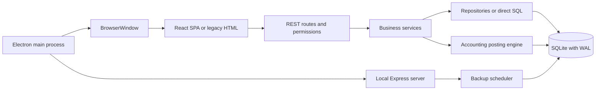

# GOLDY AUTOMOBILE ERP — project analysis

Review date: 3 October 2026. Scope: the current working tree, including existing uncommitted changes.

## Assessment

This is a substantial, implemented ERP, not a backend foundation awaiting GST development. All 13 requested core areas have backend implementations. The project also includes general-ledger accounting, quotations and sales orders, receipts and allocations, returns, warranties, loyalty, and service reminders.

The stack fits an offline workshop running on one Windows laptop. Existing business modules should be continued, not rebuilt. However, the current application should not yet be treated as production-ready: targeted checks reproduced authorization, backup, financial-reporting, costing, and duplicate-registration defects. The newer React interface also has functional gaps that backend tests do not detect.

No application source, dependencies, existing working-tree edits, or workshop databases were changed during this review. Analysis artifacts were added. Runtime checks used temporary databases and an isolated AppData path.

## Verification and limits

| Check                                          | Result                                                                                                                           |
| ---------------------------------------------- | -------------------------------------------------------------------------------------------------------------------------------- |
| Backend suite under installed Electron runtime | **156 tests passed; 0 failed; 0 skipped**, approximately 44.7 seconds                                                            |
| Same suite under system Node 22.22.3           | 17 passed; 122 failed, primarily because the installed SQLite native module targets Electron ABI 125 while Node requires ABI 127 |
| React production compilation                   | Passed; Vite transformed 1,604 modules in approximately 23.6 seconds; output written to a temporary directory                    |
| Targeted financial-report check                | Reproduced incorrect date/status exclusion                                                                                       |
| Targeted migration-backup check                | Reproduced omission of committed WAL data                                                                                        |
| Targeted API contract checks                   | Reproduced incorrect Tally path, ignored GST date parameters, and legacy root redirect                                           |
| Targeted costing check                         | Reproduced different invoice and stock-movement costs                                                                            |
| Targeted vehicle check                         | Two registration variants created two records with the same normalized registration                                              |
| Targeted permission check                      | Mechanic could export user/session tables and import replacement settings                                                        |
| npm dependency audit                           | Reported 36 affected packages: 1 critical, 28 high, 7 moderate; includes development and transitive dependencies                 |

These are source inspection, API/service checks, build checks, and automated backend tests. They are not a full interactive browser test, a fresh Windows installer certification, a Tally import test, or a legal/tax compliance certification. The existing EXE was not installed or launched against business data. A passing suite does not establish coverage of every business rule.

The source graph indexed 224 code files with local AST extraction, initially reporting 1,298 nodes and 3,243 edges. SQL graph extraction lacked its parser dependency, so migration SQL was inspected directly. No paid semantic extraction or remote code upload was used for the graph.

## Project map

The `src` tree contains 226 files, including 38 backend test files and 34 migration SQL files. A freshly migrated test database contains 76 application/tracking tables. Migration names go through `036`; two sequence numbers are absent, so the number of files is 34, not 36.

```text
src/main.js                         Electron application entry
src/server/server.js               Database initialization, backup scheduler, HTTP listener
src/server/app.js                  Express middleware and module registration
src/server/config/env.js           Environment and data-path resolution
src/server/database/               Connection, migrations, seeds, safety and recovery
src/server/modules/                20 backend module directories
src/server/shared/                 Authentication middleware, errors, tokens, logging
src/renderer/App.jsx               React routes and authentication gate
src/renderer/modules/              React feature screens
src/renderer/shared/               API wrapper, store, table, chart and layout
public/                           Built React assets plus older HTML/JavaScript screens
electron-builder.json5             Windows NSIS packaging configuration
scratch/find_sprint8.js            Ad hoc database-discovery script
```

### Runtime and data flow



Electron starts the backend inside its own main process and loads `http://127.0.0.1:4321`. The server binds to loopback. This is a local application; an offline-first sync engine is unnecessary for the current single-laptop scope.

Development defaults to `data/goldy.sqlite`; packaged production defaults to `%APPDATA%/Goldy_Automobiles/data/goldy_erp.db`. Environment overrides exist. Production data sits outside the installer directory. Demo mode can switch the active database; a proxy in `createApp` lets repositories follow the active global connection after a switch or restore.

### Architectural strengths

- Most operational modules use routes, controllers, services, and repositories.
- Critical invoice, purchase, stock, and posting operations use SQLite transactions.
- Stock movements and invoice purchase-cost snapshots exist.
- The accounting engine checks balanced entries, resolves ledgers by system key, maintains balances, allocates voucher numbers, and checks period locks.
- Authentication uses bcrypt, random sessions stored as token hashes, expiry, lockouts, and recovery codes.
- SQLite enables foreign keys, WAL, a busy timeout, and integrity checks.
- Migrations track checksums and prevent missing or altered applied files.
- Recovery, restore, audit logging, scheduling, and retention have implementations and tests.
- React has reusable tables/charts, a shared API wrapper, TanStack Query, Zustand, and permission hooks.

### Architectural weaknesses

- Layering is inconsistent: `accounting.routes.js` contains orchestration and direct SQL; several services query the database directly.
- There are overlapping financial systems: legacy `profit_records`/`expenses`/supplier ledgers and journal-based accounting, plus workshop invoices and direct invoices.
- There are two backup implementations with different methods, paths, retention rules, and consistency guarantees.
- Two UI systems remain active, with different routing and session handling.
- API response shapes and query names are inconsistent and are not checked by frontend integration tests.
- Large files concentrate many responsibilities: inventory service 1,807 lines, job-card React screen 1,039, sales-order service 809, accounting routes 598. The 5,224-line starter catalog is primarily data rather than a refactoring target.

## Module coverage against AGENTS.md

“Implemented” below means code and endpoints exist; it does not mean every workflow is verified through the desktop UI.

| Required area  | Current implementation                                                                    | Main limitation                                                                            |
| -------------- | ----------------------------------------------------------------------------------------- | ------------------------------------------------------------------------------------------ |
| Authentication | Setup, login/logout, sessions, recovery, lockout, RBAC                                    | React lacks setup/recovery screens; logout only clears client state                        |
| Customers      | Generic master CRUD, validation, lookup, customer React screen                            | React edit/delete helpers disagree with shared API/store                                   |
| Vehicles       | Master CRUD, workshop lookup, service history, normalized registration                    | Normalized registration is not unique in the database                                      |
| Job cards      | Intake, customer/vehicle resolution, parts/labour, assignments, finalization/cancellation | New intake changes are uncommitted; financial and tax assumptions need correction          |
| Inventory      | SKU, costs/prices, stock, batches, supplier, minimum stock, valuation, movements          | Counter billing disagrees with weighted-average movement costs                             |
| Multi-godown   | Warehouses, permissions, reservations, transfers and receipt/reversal workflows           | Mostly accessed through existing inventory/legacy workflows; review permissions end to end |
| Purchasing     | Orders, receipts, purchase returns, supplier ledgers; accounting purchase bills/payments  | Overlapping purchase flows; React purchasing is largely a list view                        |
| Billing        | Workshop invoices, direct invoices, payments, credit limits and allocations               | Multiple invoice/report sources are not consistently reconciled                            |
| GST            | Summary, GSTR-1, GSTR-3B, HSN, direct-sales inclusion, period locks                       | React filter/field mismatches; workshop GST calculation always splits CGST/SGST            |
| Profit & loss  | Legacy profit/expense reports and journal-based financial statements                      | Report exclusion bug and differing source coverage                                         |
| Expenses       | Validated expense CRUD and reporting; expected categories supported                       | No dedicated React route; journal/legacy consistency needs review                          |
| Tally export   | XML export from profit routes, sales or all vouchers                                      | React calls a nonexistent route; real Tally import not verified                            |
| Dashboard      | Operations, financial, inventory and sales APIs; React charts/KPIs                        | Legacy financial metrics omit direct-sales source; stale frontend tests                    |

Additional implementations: technicians, audit logs, service history, stock verification, fixed assets, sales quotations/orders/shipments, warranty registrations/claims, customer/supplier returns, CRM loyalty/referrals/promotions/reminders, demo datasets, backups and restoration.

## Findings, ordered by priority

### P0 — demo APIs bypass business permissions and expose security tables

Sources: `src/server/modules/demo/demo.routes.js`, `demo.controller.js:141` and `:159`.

All demo routes require login, but no role/permission checks. Export iterates essentially every database table, including `users` and `user_sessions`. Import accepts existing table names and deletes/replaces their contents; it has no demo-mode guard, table allowlist, pre-import backup, or admin check.

**Reproduced on a temporary database:** a Mechanic received HTTP 200 from export, with user and session tables present. The same role imported a replacement `system_settings` dataset, received HTTP 200, and reduced the settings table to the single supplied row.

Repair first: restrict maintenance operations on the server, separate business exports from security tables, validate import schemas and identifiers, require backups for replacement imports, and enforce the intended production/demo boundary. Add role-based regression tests.

### P0 — pre-migration/daily file-copy backups can lose committed data

Source: `src/server/database/backupService.js:23`, used by database initialization/migrations.

The migration backup copies only the main database file with `fs.copyFileSync`, while the database operates in WAL mode. Recent committed transactions may still be in the WAL. An integrity check can pass on the copied file even when those transactions are absent.

**Reproduced:** live database had one committed row; copied backup had zero rows; `verifyBackup` returned true.

The operational backup module already uses SQLite's backup API. Consolidate on a consistent SQLite-aware snapshot operation and verify backup content/restoration. Do not rely on physical integrity alone to establish backup completeness.

### P1 — trial balance and P&L include out-of-period/cancelled entries

Source: `src/server/modules/accounting/accountingReport.service.js:49`, `:144`; a similar pattern occurs at `:257` in the balance-sheet query.

The query joins journal entries before a filtered `LEFT JOIN` to vouchers. When a voucher fails the date/status filter, the journal entry still contributes to `SUM(je.amount)`.

**Reproduced:** June active revenue was 100, July revenue 200, and cancelled June revenue 300. Both June P&L revenue and June trial-balance credits returned **600**, instead of **100**.

Fix the join/aggregation relationship and test date boundaries, cancellations, and balance-sheet consistency. Existing balance checks cannot catch this because excluded vouchers can still be individually balanced.

### P1 — direct billing and inventory use different costs

Sources: `src/server/modules/accounting/directBilling.service.js:27` and `:52`; `src/server/modules/inventory/inventory.service.js:969`.

Inventory stock-out records item weighted-average cost. Direct billing independently computes cost from each batch's purchase cost.

**Reproduced:** batches at 100 and 200, item average 150, sale of one unit from the first batch. Direct invoice cost was **100**; inventory movement cost was **150**.

Use the canonical inventory movement cost consistently for invoice margins, COGS, valuation, and reversal. FIFO batch selection can coexist with weighted-average valuation; the two concepts should not be conflated.

### P1 — React editing and delete confirmations use missing functions

Sources: `src/renderer/shared/api/apiClient.js`; customer, vehicle, supplier and inventory React screens; `src/renderer/shared/store/useAppStore.js`.

The client exports `get`, `post`, `put`, and `del`; screens call `api.patch`, which is undefined. Several master screens select `state.showConfirm`, but the store implements `openDialog`, not `showConfirm`.

These call sites can compile successfully and fail when a user clicks Edit or Delete. Align the shared interfaces and exercise those actions in frontend tests.

### P1 — table pagination has a recursive setter

Source: `src/renderer/shared/components/DataTable.jsx:40`.

The `onPaginationChange` callback calls `table.setPagination`. TanStack's installed implementation invokes `onPaginationChange` from `setPagination`, creating a recursion path. It also mixes a server-paginated subset with client-side paging/sorting.

This is established by source tracing, not by an interactive browser reproduction. Manage pagination state directly and define server/client paging boundaries explicitly.

### P1 — React onboarding, navigation and logout are incomplete

Sources: `src/renderer/modules/auth/Login.jsx`, `src/renderer/App.jsx`, `src/server/app.js`, `src/renderer/shared/components/Layout.jsx:136`.

React only implements sign-in; first-time administrator setup and password recovery exist in the older `public/login.js`, whose original HTML shell has been replaced by the React entry. A fresh install therefore lacks the intended setup flow in the current SPA.

An authenticated request to `/` redirects to `/dashboard.html`, confirmed with an API check, so restarting/reloading can send the user into the older interface. React logout clears session storage but does not call server logout or clear the server's HttpOnly cookie/session.

Choose and complete the React shell as the canonical entry, including setup, recovery, session verification, logout and reload behavior. Preserve older workflows until their replacements are verified.

### P1 — GST screen filters and displayed totals disagree with the API

Sources: `src/renderer/modules/reports/ReportsManager.jsx:34`, `:46`, `:256`; `src/server/modules/gst/gst.service.js:49` and `:87`.

The React screen sends `startDate`/`endDate`; the GST service accepts `dateFrom`/`dateTo` or `from`/`to`. The React cards expect `totalTaxableValue`, `totalCgst`, etc.; the server returns `taxableValue`, `cgstAmount`, etc.

**Reproduced:** requests using the React parameters returned null date filters. Source inspection shows valid results can render as zero because the expected property names do not exist.

Align filter and DTO contracts; test with known nonzero invoices on both sides of the requested period.

### P1 — Tally action calls a nonexistent API

Sources: `ReportsManager.jsx:105`; `src/server/modules/profit/profit.routes.js:17`.

The React button calls `/api/v1/tally/export`; the implemented route is `/api/v1/profit/tally-export`. The React path returned **404** in the probe. It also uses date query names unsupported by the profit filter parser.

Wire the button to the actual endpoint and validate an exported file in the intended Tally installation.

### P1 — company profile save is a false success

Source: `src/renderer/modules/settings/SettingsPortal.jsx:65`.

The form initializes sample values. Its save handler only prevents form submission and displays “Company profile updated successfully.” It neither loads the stored company profile nor persists edits.

Wire load/save to the appropriate storage/API contract and show success only after persistence succeeds.

### P1 — demo purge identifies real data using unsafe heuristics

Source: `src/server/modules/backup/backup.controller.js:144`.

Cleanup matches timestamp-like invoice/job-card prefixes, opening-stock transaction types, ordinary opening-batch names, a phone number, and supplier IDs 1–4. These are not reliable demo ownership markers. A backup is taken first, but the operation can target legitimate opening stock and suppliers.

This was inspected, not executed against workshop data. Use explicit demo provenance or confine cleanup to the demo database; remove heuristic deletion of production records.

### P1 — registration normalization does not enforce uniqueness

Sources: migration `036_add_vehicle_normalized_registration.sql`; `masters/master.service.js:77`.

Migration 036 adds an ordinary index rather than a unique constraint. The generic vehicle master accepts distinct display strings with the same normalized identity.

**Reproduced:** `HR26AB9999` and `HR-26-AB-9999` both returned HTTP 201 and produced two normalized matches. Resolve existing duplicates before introducing a database uniqueness rule; do not silently merge ownership/history.

### P2 — finance definitions and source coverage need one explicit contract

Sources: `jobCards/jobCard.service.js:554`, `profit/profit.repository.js`, `dashboard/dashboard.service.js`, direct billing and expense services.

- Workshop invoices persist `net_profit` equal to gross profit. Period profit reports subtract operating expenses separately. That does not implement a defined invoice-level expense allocation.
- Workshop labour and outside-job lines use zero cost, so the current margin does not capture outsourced job costs.
- Legacy profit queries join `profit_records` to workshop `invoices`; direct counter sales are absent from that path. Dashboard financial metrics reuse it.
- Workshop finalization always splits GST into CGST/SGST; it does not use the interstate decision found in direct billing. The legacy purchase-receipt posting similarly splits input GST.

Agree on cost and expense-allocation definitions, make report scope explicit, and reconcile legacy and journal totals. Tax treatment should be validated against the business's actual transactions before relying on reports for filing.

### P2 — lists, cache invalidation, and UI DTOs need alignment

The React master screens request `limit`, `sortBy`, and `sortOrder`; master parsing uses `pageSize` and repository ordering is fixed to descending ID. TanStack Query v5 is installed, while many mutations use the older array-style `invalidateQueries(['key'])` call rather than filter objects. Purchasing list columns reference `purchase_number`/`purchase_date`, while orders store `order_number`/`order_date`.

AccountingPortal requests financial reports without their required dates. Several screens substitute empty/zero defaults instead of surfacing failed queries, which can hide broken integrations.

### P2 — session and input hardening is uneven

Password reset updates the hash and recovery code but does not revoke existing sessions. React logout also leaves server sessions active. Some older screens interpolate database content into `innerHTML`; one example is inventory autocomplete at `public/inventory.js:425`. Review these for safe text rendering even though CSP reduces some script execution paths.

Local execution is helpful but does not replace role authorization, especially when ordinary authenticated users can invoke maintenance APIs.

## Tests, tooling and release readiness

The backend suite covers authentication, validation, masters, inventory, purchasing, job cards, financial postings, GST, dashboards, backup/restore, migration/recovery, returns/warranties, CRM, and stress scenarios. The new workshop tests cover customer/vehicle matching, normalized lookup, preserving ownership, explicit ownership transfer, and historical links. Those eight cases passed.

The included stress test generated over 4,000 vouchers and measured trial balance at 11 ms, P&L at 2 ms, and balance sheet at 8 ms on this machine. These demonstrate useful local performance, not correctness of excluded-date/status scenarios or a general performance guarantee.

Frontend testing is not operational: a dashboard test imports `@testing-library/react` and uses Jest globals, but neither the dependency nor a Jest configuration/script is declared. `npm test` only discovers `src/server/tests/*.test.js`. There are no declared lint/typecheck commands or GitHub Actions workflows. The “React SPA integration” backend test does not exercise Edit/Delete, pagination, setup, or rendering.

The SQLite native dependency needs a documented runtime strategy. The currently installed binary works with Electron 31.0.0 / embedded Node 20.14.0, but not system Node 22.22.3. Avoid rebuilding it casually, because a rebuild for one runtime may break the other. A reproducible development/test/package process is required.

Windows packaging configuration includes x64 NSIS, ASAR, SQLite unpacking/rebuild, shortcuts, production exclusions, and preservation of AppData on uninstall. An EXE exists, but its provenance and freshness relative to current source were not established. `build:win` does not run the frontend build first, so it can package stale `public` output. Vite deliberately does not empty `public`; many older hashed assets accumulate there and can be packaged.

Electron startup awaits the server module import rather than a promise that resolves when the listener is ready. Server listen errors and failed page loads need explicit handling and a user-visible recovery path. The synchronous database and Express server share Electron's main process, so large imports/reports can affect desktop responsiveness.

The npm audit findings require dependency triage. Counts refer to affected dependency entries, not 36 independently exploitable runtime flaws; many are installer/build dependencies. Do not run a forced audit upgrade without evaluating major-version migrations and rebuilding/testing SQLite and the installer.

## Documentation and active work

`PROJECT_STATUS.md` and `CONTINUE.md` still say Phase 6/GST is next and only 19 tests pass. `DEPLOYMENT_PROGRESS.md` marks backup/logging/installer work pending despite implementations. These files must not guide the next implementation step until updated.

Existing uncommitted work includes the job-card React screen, job-card routes/service, master config/service, migration 036, workshop workflow tests, and frontend build outputs. The intake work distinguishes the job-card customer from the vehicle master owner and supports explicit ownership transfer. Preserve that intent and strengthen duplicate prevention rather than recreating it.

`scratch/find_sprint8.js` recursively opens `.sqlite`/`.db` files and prints customer schemas. It is not application code and does not establish sprint completion. It opens databases in the default writable mode and suppresses errors, so use an explicit read-only database inspection tool for future investigations.

## Suggested work order

1. **Protect data and permissions:** restrict demo export/import/maintenance; eliminate unsafe purge rules; replace file-copy WAL backups. Add focused reproduction tests first.
2. **Correct financial invariants:** fix date/status report exclusion; unify costing and reversals; reconcile workshop/direct-sales/expense coverage and define invoice net profit.
3. **Finish the active workshop change:** enforce normalized registration uniqueness after auditing duplicates; preserve owner/history behavior; add collision and conflicting-identity cases.
4. **Make React workflows functional:** fix API/store/table contracts, GST/Tally settings, pagination and cache updates; complete setup/recovery/logout; resolve legacy navigation.
5. **Establish release verification:** make the test runtime reproducible, add working frontend/action tests and linting, align docs, triage dependencies, build fresh frontend assets and validate a Windows installer with isolated data.
6. **Then extend features:** use confirmed workshop priorities to finish missing React operational screens and reporting. CRM expansion should follow core financial and data-safety repairs.

The next step should be a focused stabilization task, not a project rewrite or resumption of the obsolete “implement GST” plan.

## Saved evidence

- [Backend test summary](analysis/backend-test-summary.txt)
- [Targeted reproduction results](analysis/probe-results.txt)
- [npm dependency audit](analysis/dependency-audit.json)
- [Source dependency graph](graphify-out/graph.json)

Full test logs, isolated frontend build output, and the temporary probe script remain under `C:/Users/karan/AppData/Local/Temp/goldy-analysis-94b68a6298e94272827a8c3f63785407`. The graph uses source paths relative to `src`.
